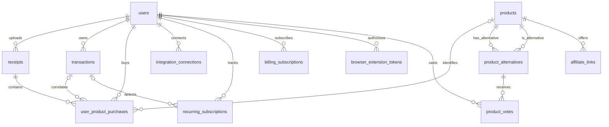

# Aliena data relationships

The purchase-intelligence model extends the existing PostgreSQL/Drizzle database. It does not replace the current user, transaction, receipt, or budget-plan tables.

`integration_connections.encrypted_credential` is intended for server-side encrypted provider credentials only; tokens must never be returned to the browser. `browser_extension_tokens` stores token hashes, not raw extension credentials. Plaid, email, Stripe, and extension traffic still require provider-specific consent, credential encryption, webhook validation, and authorization before production connections are enabled.
